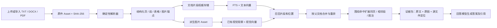

# 文档模态：解析、记忆、检索与溯源设计

状态：P0/P1 基线已实现（2026-11-03）；P2/P3 尚未实现。

当前对外推荐入口为 `POST /api/v1/import`，它通过后缀、MIME 与文件签名自动路由；
文档专用入口 `POST /api/v1/documents/import` 和媒体专用入口
`POST /api/v1/media/import` 继续保留。文档检索入口为 `GET /api/v1/documents/search`。
已覆盖 TXT、DOCX、可复制文字 PDF 的原件保存、结构解析、独立 FTS、
`document_chunk` 文本向量、源位置回溯与相邻块扩展。实现刻意不创建 Observation，
也不进入图片、音频、事件或 Agent 链路；扫描 PDF OCR、文档内图片和回答引用留到 P2/P3。

## 目标与边界

支持 `.txt`、`.docx`、`.pdf` 的导入、原件保存、文字与图片检索，并使回答能引用文件名、页码或段落位置。旧式 `.doc` 先明确提示转换为 `.docx`；若要支持 `.doc`，另加隔离的 LibreOffice 转换步骤。扫描版 PDF 通过 OCR 补文字。文档正文和图片均属于**同一源文档的证据**，不能把图片识别描述当作原文事实。

## 与现有仓库的关系

| 已有能力 | 位置与现状 | 文档模态的用法 |
|---|---|---|
| 原始资产 | `assets` 与 `FileSystemMediaStorage` 保存原件、SHA-256、scope | 源文档作为普通 `Asset`，`media_type=text`；补规范 MIME 和文件格式识别 |
| 派生资产血缘 | `assets.parent_asset_id`、`derived_kind` 已用于视频关键帧 | 文档图片可以复用 `image` Asset 与现有图片观察/视觉索引；页码与图片锚点需另建文档表，不占用视频专用的 `source_frame_index` 语义 |
| 文本向量 | `memory_vectors` 是 SQLite 权威存储；`semantic/episodic` 与 `RetrieveTextAnn` | 每个文档片段写独立 `source_type=document_chunk` 的语义向量；不能把整篇长文塞进一条 Observation |
| 视觉向量 | 图片 Asset 写 `visual`，Qdrant 是可重建镜像 | 派生图片沿用图片处理；文字查询可经视觉通道命中图片 |
| 词法召回 | `observation_search_fts` 面向 Observation/Asset | 文档片段建独立 FTS，保留片段 ID 与页号；复用查询归一化与融合逻辑 |
| 音频上下文 | `ExpandAudioContext` 在命中后扩邻段 | 文档照此在**召回后**扩相邻段与图注，扩展内容不改变召回分数 |
| Agent 工具 | `search_memories` 返回 Asset 级 preview、handle 和证据摘要 | 扩展为文档命中 preview + `read_document_context` 精读工具；解析是入库服务，不应依赖 Agent 恰好调用某个工具才发生 |

当前 `MediaType.from_file_name` 会把未知后缀归为 `TEXT`，但 `ImportAssets` 只对 image/video/audio 运行专门处理；因此“上传文件被保存”并不等于 PDF/DOCX 已解析或可检索。文档入口需增加**文件签名、后缀、MIME 一致性检查**，避免任意未知文件落入文档解析器。

## 数据模型与溯源

推荐保留两层资产、一层结构化证据：

1. `assets`：源文件原样保存；稳定 `asset_id`、`scope_id`、`content_sha256`、文件名、MIME、大小、导入状态。重解析时原件不变。
2. `document_elements`（新增，权威）：`id, document_asset_id, revision, ordinal, kind, page_no, section_path, text, source_locator, parser_version, confidence, created_at`。`kind` 为 `heading/paragraph/table/caption/image_ref` 等。`source_locator` 存 PDF 页码和 bbox、DOCX 段落路径或 TXT 行号与字符区间；页码允许为空（DOCX/TXT 不一定有稳定页码）。表格至少保留行列关系和可检索的纯文本投影。
3. `document_chunks`（新增，权威）：`id, document_asset_id, revision, ordinal, text, start_element_id, end_element_id, section_path, page_start, page_end, token_count`。用于搜索，片段范围映回原始元素。按标题/段落边界切分，建议目标 300–600 tokens、少量重叠；跨页时记录页码区间，不伪造单页来源。
4. 文档图片：每张实际有意义的图片存为 `image` Asset，`parent_asset_id` 指向源文档，`derived_kind=document_image`；新增 `document_images(document_asset_id, image_asset_id, element_id, page_no, bbox, caption_element_id, revision)`。图像内容与图注分开保存，关联起来供扩展。
5. 派生索引：`document_chunk_fts` 存 chunk ID、scope、可搜索文本；`memory_vectors` 用 `source_type=document_chunk, source_id=chunk_id`，metadata 至少含 `asset_id, revision, page_start/page_end, section_path`。图像向量沿用 `visual/asset`。

`revision` 表示解析版本；同一文件重解析或 OCR/模型升级时，先生成新版本并完成索引，再原子切换 active revision，旧版本从可检索索引撤除。文本向量的幂等键必须包含当前嵌入模型和片段版本，避免正文变化而向量仍旧。

## 解析与质量分流

| 格式 | 优先提取 | 兜底与定位 |
|---|---|---|
| TXT | 检测 UTF-8/UTF-16 等编码，保留原始行号/字符偏移与段落 | 编码无法可靠判定则标记失败，不把乱码入索引 |
| DOCX | 按文档顺序读取标题、段落、表格、图片、图注 | 以段落/表格路径定位；页码不可靠，只有经过可重复的分页渲染后才填页号 |
| PDF | 先按页面抽取带坐标的文字块和图像，重建阅读顺序 | 页面文字极少或明显乱码时才 OCR；保留 `extracted_text`/`ocr_text` 的来源与置信度，处理双栏、页眉页脚和重复文字 |

解析器只产生结构化证据，不生成总结性“事实”。OCR、图像 VLM 描述是**派生解释**，保留模型与版本；低质量 OCR 可留存但暂不索引。限制文件大小、页数、解压后体积与解析耗时；异常文件的原件和明确失败状态都可追踪。

## 检索、上下文和回答

1. 对问题同时查 `document_chunk_fts`、`semantic/document_chunk`、已有 `visual/asset`。各路保留命中的 `chunk_id` 或 `image_asset_id`，并映射到父 `document_asset_id`；不能在召回层过早只剩父 Asset ID。现有 `RetrieveTextAnn` 按 Asset 聚合、`EvidenceHit` 只带音频时间锚点，需扩展成通用的“命中位置”结构。
2. 按父文档聚合和重排时控制单文档占位数，保留每份文档最强的 1–3 个具体锚点；图注/正文和图片互相加分，但同一张图及其图注不能当两份独立证据虚增分数。
3. 对最终命中扩展：同标题下前后 1–2 个段落；表格命中补表头和整行；图片命中补图注及相邻正文。设每个锚点与整轮总 token 预算，去重并保持原文顺序。
4. Agent 的 `search_memories` 预览显示文件名、格式、标题路径、页码/段落定位和短摘录；`read_document_context(result_set_id, evidence_handle)` 返回有边界的原文、相关图像句柄、页码/bbox 或 DOCX 段落定位。图片需要细看时复用图片查看能力。
5. 给 VLM/回答模型的证据包区分 `source_text`（原文）、`ocr_text`（识别文字）、`image_description`（模型解释）。引文应绑定 `document_asset_id + revision + element/chunk_id + locator`，用户可打开原件并跳转到 PDF 页码或定位到 DOCX/TXT 段落；跳转能力缺失时至少显示明确的段落引用，不声称精确页码。

建议不要把全文直接塞入提示词。长文问答采用“片段召回 → 命中扩展 → 有界证据包 → 回答”，并将文件正文视为不可信内容，不执行文件中的指令。回答中引用的是原文及其位置，图像描述仅作辅助。

## 分阶段实施与验收

| 阶段 | 交付 | 验收重点 |
|---|---|---|
| P0：存储与解析（已完成基线） | 原件 Asset、格式校验、`document_elements/chunks`、TXT/DOCX/可复制文字 PDF | 同一文件幂等导入；文本顺序、表格、段落/页码定位可回到原件；解析失败可见 |
| P1：文本检索（已完成基线） | chunk FTS + 向量、定位锚点、按文档聚合、邻段扩展 | 精确词和语义改写均能命中正确段落；向量侧车失败时 FTS 仍可用 |
| P2：图片与扫描 PDF | 派生图片 Asset、图注关联、OCR 回退、视觉检索 | 文字题、图片题分别召回正确页面；OCR 不覆盖可复制原文；点击来源能回原件 |
| P3：Agent 与回答 | 搜索预览、精读工具、证据包、引用展示 | 答案可附文件与页/段；图片和正文冲突时保留来源；无证据时不会编造引用 |

先做一个不依赖前端的端到端测试：用一份含标题、表格和插图的 DOCX、一份混合文字/扫描页的 PDF、一份 TXT，验证上传 → 原件留存 → 解析 → FTS/向量/视觉召回 → 上下文扩展 → 引文回跳。再用真实文件集测 chunk 召回率、引用定位准确率、延迟和存储增量。

## 需在实现前确定的产品口径

- 用户所说“Word”若包含旧 `.doc`，是否接受服务端转换；默认一期只支持 `.docx`。
- 是否要求 DOCX 的物理页码；默认以标题/段落定位为准，PDF 才承诺页码。
- 图片处理范围：默认提取嵌入图与 PDF 中有语义价值的图，不把每页整张渲染图都作为视觉资产，以控制存储与推理成本。

以上三个选择不影响 P0 的原件保存和结构化文本基础，可以先按默认值推进。
