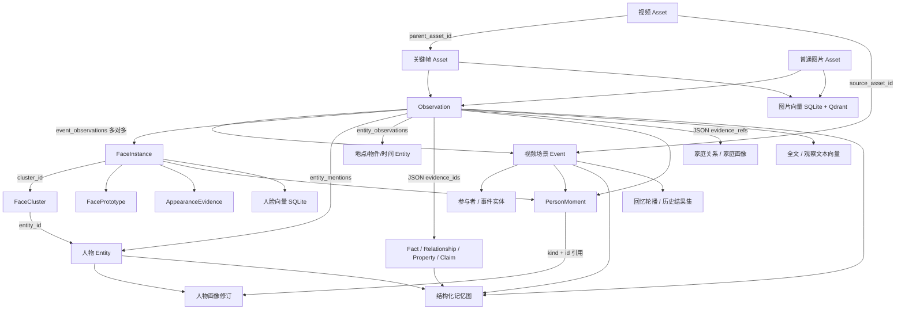

# 图片与视频删除：多模态记忆结构分析

- 分析日期：2026-11-10；基线：`main` / `65ce640b`。
- 范围：静态分析产品 API、领域模型、迁移、仓储、导入及后处理、索引和文件写入；未启动删除、迁移或模型任务，未修改业务逻辑。
- 路径均相对于仓库根。本报告说明代码契约，不代表对当前运行数据库所有历史数据完成了完整性审计。

## 1. 结论

当前具备资产→观察→人脸/事件的结构化血缘，但不存在统一的依赖反查和删除事务。共享事实、关系、属性、画像的大量来源保存在 JSON，不能靠外键级联完成删除。视频已有 `SqliteVideoRepository.cleanup_derivatives()`，只能视为重处理清场代码，不能直接用作产品素材删除。

删除单位应为资产及其派生闭包，不是人物、簇或整个事件。共享对象先保存受影响ID和证据清单，再撤除目标素材贡献、基于剩余证据更新。人物档案不因素材删除而删除；摘要、画像、记忆图后续异步重建前，需要失效控制和版本保护。

## 2. 存储根与数据模型

`apps/api/src/sentrix/config.py` 的 `Settings` 定义默认根；实际根以运行环境 `SENTRIX_DATA_DIR` 为准，不能硬编码 `data/`。

- SQLite：`<data_dir>/sentrix.db`，权威结构化数据及向量。
- 媒体：`<data_dir>/media`；图片预览：`<data_dir>/previews`。
- Qdrant：`<data_dir>/qdrant`，本地嵌入式派生索引，有进程独占锁。
- 视频派生物：`media/derived/video/<asset_id>/`；场景规划缓存还包括 `media/derived/svd`、`svd_katna` 等路径。
- 视频任务产物：`<data_dir>/video-jobs/<job_id>/speech.json`、`scene_windows.json` 及临时文件。
- 人脸模型预览/裁剪存在系统临时文件，不能假定全部落在 media 目录。

| 对象 | 模型/契约 | SQLite 落点 | 所属关系 |
|---|---|---|---|
| 图片、视频、关键帧 | `domain/media/models.py`: Asset、DerivedAsset、VideoMetadata | assets；视频探测、预览路径等在 metadata_json | 关键帧仍是 image Asset，以 parent_asset_id 指向原片 |
| 观察与候选事实 | 同文件 Observation、ObservationFact；media/ports.py ObservationSemantics | observations（caption、OCR、place、people_json、facts_json 等） | asset_id 外键，单资产可有多条观察 |
| 地点解析 | domain/places/models.py Place | asset_places，含 nearest_evidence_json | asset_id 主键及外键 |
| 人脸检测实例 | domain/identity/models.py FaceInstanceRecord | face_instances | asset_id、observation_id、cluster_id |
| 人脸簇与原型 | FaceClusterRecord、FacePrototypeRecord | face_clusters、face_prototypes | 簇可跨多份素材，entity_id 连接人物；原型引用具体实例 |
| 人物、地点、物件、时间等实体 | EntityRecord | entities | 人物不是独立 people 表；entity_type 区分 |
| 实体与证据桥 | EntityMentionRecord、EntityPropertyRecord 等 | entity_mentions、entity_observations、entity_properties、entity_revisions | 人物提及和非人物实体桥分开；属性/修订含JSON证据 |
| 事件及摘要 | domain/memories/events.py EventRecord（ports.py引用） | events、event_observations | 事件summary/title等是字段，不是独立摘要表 |
| 参与者、事件实体 | domain/memories/events.py EventParticipantRecord、EventEntityRecord | event_participants、event_entities | 事件共享关系，evidence_ids_json |
| 事实 | domain/memories/facts.py Fact | facts | subject/predicate/object 字符串；证据JSON，不是人物ID外键 |
| 实体关系 | domain/identity/models.py RelationshipRecord | relationships | 两端实体ID外键，evidence_ids_json；确认/来源/状态信息 |
| 外观、人物瞬间 | AppearanceEvidenceRecord、PersonMomentRecord | person_appearance_evidence、person_moments | 指向人物、实例、资产、观察；瞬间还指向事件 |
| 人物画像修订 | PortraitRevisionRecord | person_portrait_revisions | person_id；themes_json、evidence_refs_json、锁定/历史状态 |
| 非人物语义档案/主张 | SemanticProfileRecord、SemanticClaimRecord | semantic_profiles、semantic_claims | person_id 实际可为非人物实体；证据/支撑事件JSON |
| 家庭关系与画像 | domain/identity/family_graph.py 及 family.py | family_person_memberships、family_relationships、family_relationship_blocks、family_analysis_runs、family_person_portraits、family_scope_groups | 独立于 relationships 和人物画像修订；可能跨scope聚合 |
| 结构化记忆图 | domain/memories/graph.py GraphNode、GraphEdge等 | memory_graph_nodes、memory_graph_edges、memory_graph_builds | scope原子替换，无源数据外键 |
| 向量、全文 | domain/retrieval/ports.py VectorRecord | memory_vectors、text_vectors、observation_search_terms、observation_search_fts | source_type+source_id；全文同时保存资产和观察ID |
| 回忆序列 | application/memories/read_rotation.py | memory_rotation_sequences、memory_rotation_viewed | event_ids_json及已看事件ID，无事件外键 |
| 任务和历史引用 | domain/media/import_jobs.py、domain/assistant/models.py | import_jobs/stages、scope_postprocess、video_jobs/stages、agent_* | 任务路径、结果集、消息、轨迹可能继续引用已删素材 |

结构定义以 migrations/0002、0003、0005—0010、0014—0027 为准；不能只看初始建表文件，后续迁移增加视频血缘、JSON语义、文本向量、任务和时间字段。`semantic_profiles` 本次在Python中找到读仓储，未找到业务写入器，不应将其描述成已自动生成的完整链路。

## 3. 数据关系图

箭头表示可追踪的业务依赖，不全部是数据库外键。Event 是通用类型，普通照片事件同样通过 event_observations 连接。

### ID 语义与反查

1. `asset_id`：一份已入库素材或派生帧。先展开 `assets.parent_asset_id`，不要用文件名或人物ID猜血缘；当前直接派生路径较明确，未来实现应允许递归闭包。
2. `observation_id`：该素材的一条观察；必须查询全部观察，不能仅取最新一条。
3. `face_instance_id`：一次具体检测。`EnrollFace.enroll → _store → SqliteFaceRepository.add_instance` 每次生成新 `face_*` 并绑定资产/观察；匹配到相同cluster不复用实例。去重导入复用资产是另一回事，不能假定上传次数等于资产数。
4. `cluster_id`：共享检测簇；收集成员删除前后的集合。`entity_id/person_id`：人物或实体身份，不等于实例ID。
5. `evidence_ids` 不是统一类型外键。MaintainFacts、MaintainObservationEntities通常写 observation.id；画像使用 `{kind,id}`，可能间接指向 person_moment；家庭推断常用观察ID，人工来源可无素材证据。不能拿同名字段统一按asset_id处理。
6. 收集顺序：资产闭包 → 全部观察 → 人脸及簇/人物 → 关联事件 → 证据集合交集命中的事实/关系/属性/主张 → 瞬间/画像/家庭档案 → 图、轮播、历史引用。受影响对象及其原证据、文件路径应在删除前持久化，避免删后无法反查。
7. 每一步限定用户数据根和scope；家庭图可跨scope，需沿family_scope_groups查实际影响，不能全库模糊删除。

## 4. 写入链路与代码入口

以下路径前缀为 `apps/api/src/sentrix/`。后文附录自动列出仓储方法中的SQL修改入口，便于逐项审查。

### 4.1 API、任务与装配

- `api/routes/media.py`：单文件导入、视频任务调度/阶段执行、语音与场景规划产物、预览缓存写入；文件交付也是未来删除状态检查点。
- `api/routes/import_jobs.py`：接收/取消/重试导入任务；`infrastructure/persistence/repositories/import_jobs.py` 保存租约、fence、取消请求和scope后处理代次。
- `api/routes/timeline.py`：整册导入、流水线和总结/insights/家庭图调用。
- `bootstrap/import_wiring.py`：`build_import_assets`、`_build_importer`、`build_video_scenes`、`build_video_job_processor`、`build_media_postprocess`、`_run_insights`、`_run_family_graph`、`refresh_memory_graph`。本版装配已从media路由抽出，不能按旧分支位置改造。
- `bootstrap/container.py`：SQLite/Qdrant/文件根及各仓储实例装配。
- `api/routes/identity.py`、relationships.py、family.py、facts.py、insights.py：命名、确认/合并/拆分、属性、关系、事实审核、画像与分析写入口；不是只有导入链会修改记忆。

### 4.2 资产、观察、地点和视频

- `application/media/import_assets.py` 的stage/execute/process相关流程：存储原片、assets.add、observations.add，写探测元数据，提交语义并调用事件、人脸、事实、实体、索引协作者。
- `application/media/observe_asset.py`：prepare调用模型，commit调用observations.enrich；推理和提交分离，是删除竞争关键点。
- `application/media/index_place.py`：IndexAssetPlace.index → asset_places.save。
- `application/media/extract_video_scenes.py`：场景事件、add_derived、帧提取、关键帧图片记忆处理；关键帧forced_event_id关联视频场景。
- `infrastructure/persistence/repositories/assets.py`：SqliteAssetRepository.add/update_status；SqliteObservationRepository.add/enrich。
- `.../video.py`：save_probe/save_processing_*写metadata；add_derived/refresh_derived_file写派生资产；create_job/update_job/update_stage保存任务；cleanup_derivatives清场。
- `.../audio.py` save_probe：assets.metadata_json；视频转写和对齐内容还需从场景source_metadata、观察与任务文件一并清理，不能假设有独立transcripts表。

### 4.3 人物、实体、事件及共享记忆

- `application/identity/enroll_face.py`：实例落库、簇匹配、新簇、refresh_prototypes、人脸向量、已确认提及；`seed_identity.py`另有人物参考图/人脸向量路径。
- `application/identity/review_cluster.py`、recluster.py、name_person.py：人工确认、合并、拆分、重聚类、改名；涉及实体、提及、簇/原型、家庭角色事实、事件参与者和重分段。
- `application/media/maintain_entities.py`：find_or_create_entities、link_observation、maintain_property(_values)、关系create、事件实体投影。
- `application/memories/assign_events.py`：create/attach/fold、参与者、共现关系、事件合并、摘要更新；参与者refresh主要是upsert，不是撤除旧证据的完整反向操作。
- `application/memories/maintain_facts.py`：insert/reinforce；review_fact.py确认/撤回；`facts.purge_unanchored`不能代替素材级证据撤除。
- `application/memories/summarize_event.py`：SummarizeEvent.execute → events.apply_summary。
- `application/identity/observe_appearance.py` → appearance.record；extract_moments.py → moments.upsert；run_insights.py → portraits.create。
- `application/identity/create_relationship.py`、import_relationships.py → relationships.create及semantic.maintain_claim；review/人工关系路径也要保留来源差异。
- `application/identity/family_graph_service.py` → family.set_membership/set_relationship/write_portrait/create_run/update_run等；不能只处理普通relationships表。
- `application/memories/build_graph.py` → memory_graph.replace_scope，整scope原子替换；不是已有的局部增量删除能力。
- `application/memories/read_rotation.py`与memory_rotation仓储保存每日稳定事件序列和已看状态。

### 4.4 向量和全文

- `application/retrieval/index_visual.py`：图片向量先写SqliteVectorRepository，再镜像QdrantVectorIndex.upsert（已有SQLite向量也可再镜像）。
- `application/retrieval/index_observation_text.py`：写text_vectors中semantic/observation、episodic/observation、episodic/event。事件行的metadata包含observation_id，是观察向量的事件挂接，并非保证为独立事件摘要向量；重建时必须防旧挂接残留。
- enroll_face.py、seed_identity.py：visual/face_instance写memory_vectors；不能据Qdrant通用端口推断所有人脸/文本已经镜像Qdrant。本版文本ANN读取SQLite；主图片索引链明确镜像Qdrant。
- `infrastructure/persistence/repositories/vectors.py` VectorTableRepository.upsert/update_metadata；text_vectors.py复用实现，表不同。唯一键包含space/source_type/source_id/model_name，不含scope，删除不能只匹配source_id或假定一个模型一条。
- `infrastructure/vector/qdrant_index.py`：collection按space/model/dimension，payload含scope/source_type/source_id/metadata；point UUID由space/source_type/source_id/model构造。目前有upsert/search/count，无删除端口。必须按完整身份定位点，不能删除共享collection。
- `infrastructure/persistence/repositories/search_terms.py` refresh_from_observation：同事务删除旧terms及FTS，再写两者；rebuild_scope是全scope重建。FTS不是随资产外键自动级联。
- 维护路径：`scripts/backfill_visual_vectors.py`、`scripts/backfill_text_vectors.py`、`scripts/maintenance/text_vector_migration.py`及text_vectors_migrate.py。补写/迁移/恢复也可能把旧数据重新带入，后续需遵守删除状态和版本。

### 4.5 文件写入

| 入口 | 产物与追踪方式 |
|---|---|
| infrastructure/media/storage.py store/move_from_path/copy_from_path | media/{asset_id}_{sanitise(name)}，asset.path；staging_dir为media/.staging；目录导入copy而非删除用户原文件 |
| infrastructure/media/video_transcode.py browser_preview/transcode_to_h264 | media/derived/video/{asset_id}/preview.mp4；probe元数据也保存交付路径 |
| infrastructure/media/video_keyframes.py extract | derived/video下视频帧；结合asset.path和parent_asset_id查归属 |
| infrastructure/media/svd_keyframe.py场景分析 | planner输出目录中的分析JSON/帧；另有svd_katna等planner实现，见文件写入附录 |
| api/routes/media.py _cached_image_response | previews/{asset.id}-{max_dimension}.jpg及原子替换临时文件；不同尺寸均需覆盖 |
| api/routes/media.py视频阶段 | video-jobs/{job_id}/speech.json、scene_windows.json、临时文件；video_job_stages.output_artifact记录部分产物 |
| infrastructure/media/person_vision.py render_person_crop/render_numbered_preview | NamedTemporaryFile(delete=False) JPEG；调用方负责finally清理，异常/进程退出仍需盘点 |
| infrastructure/media/video临时音频适配器 | ffmpeg/ASR中间文件；见附录相关代码，不能按永久资产路径查到所有临时件 |

文件归属不完全由数据库记录，当前没有统一artifact registry，也未发现通用文件引用计数。普通原片按资产ID命名不等于所有缓存都独占；不能把共享文件引用计数描述为现成功能。

## 5. 删除影响范围

### 5.1 图片

先确定它不是视频派生帧（第一版建议不开放单独关键帧删除）。删除闭包含assets行、所有observations、该素材的asset_places、人脸实例、直接提及/实体观察桥、外观/瞬间、全文和源向量、预览及受管文件。

entity_mentions等关联行属于待删除边，不等于删除另一端人物。face_prototypes虽引用某实例，但代表整个簇，应先收集簇ID，撤除引用后从剩余成员重建。人脸嵌入在实例列、簇代表向量、原型表和memory_vectors存在多处，不可漏掉或整簇清空。

### 5.2 视频

原片 + assets派生闭包 + 对应全部观察/人脸/索引；另外包括source_asset_id关联的场景事件、视频任务与阶段产物、转码预览、帧文件、场景规划缓存、转写JSON。需检查场景事件是否还有闭包外观察或其他引用，不能仅凭source_asset_id无条件删除所有引用方。共享普通事件按剩余观察处理。

### 5.3 共享对象的更新规则

| 对象 | 删除后的规则 |
|---|---|
| 人物实体/姓名/家庭身份 | 保留，即使关联素材归零；不调用delete_candidate替代素材删除 |
| 簇/原型/代表脸 | 保留其他实例；重算数量、代表嵌入、姿态桶原型；空未确认簇单独决策 |
| 事件 | 删除目标观察桥；据剩余成员重算时间、地点、封面、参与者；空事件再清理引用并移除；失去桥接证据可能需重分组 |
| 事实/关系/属性/语义主张 | JSON精确撤除目标证据，保留其他证据；重新评估结论而非仅减数量；人工来源/确认内容保留身份与历史，标示证据变化 |
| 参与者/事件实体 | 从剩余观察重算，不能只执行现有upsert刷新；移除不再被支持的关联 |
| 画像/语义档案/家庭画像 | 追踪直接和瞬间/事件间接证据；旧版本失效控制；从有效原始证据重建，不能把旧摘要当事实继续输入 |
| 记忆图 | 先过滤/失效旧引用，随后scope replace；无源外键不代表无需清理 |
| 回忆/结果集/对话 | 轮播移除无效事件，修正游标；历史结果引用须校验存在性；保留历史文本不意味着允许访问已删文件 |

不是所有变化都要调用模型：关联、成员数、原型、封面可同步更新；摘要/画像/复杂事件整理异步处理。重建期间不能让旧派生记忆继续充当有效证据。

## 6. 来源追踪能力与风险

| 等级 | 发现 | 后续要求 |
|---|---|---|
| 精确 | assets→observations、parent_asset_id、face_instances、event_observations、外观/瞬间的结构化外键 | 保存删除前闭包；按引用者优先的顺序处理 |
| 可解析但无FK | facts/relationships/entity_properties/semantic_claims等JSON证据 | 按字段实际ID类型精确集合运算；禁止LIKE子串判定归属 |
| 间接 | portrait evidence_refs使用kind/id指向person_moment；家庭聚合、支撑事件列表 | 展开瞬间/事件/家庭scope链；不能仅查资产ID |
| 不完整 | events.summary、entities.summary、代表嵌入、累计confidence、部分档案文本无逐句来源和完整输入快照 | 定位受影响对象后整体失效/重建；不能保证精准删除一句话 |
| 来源差异 | 人工属性、关系、画像锁定、事实确认不等于自动证据；facts缺统一source及人工确认来源字段 | 不能简单“证据空→删所有记录”；明确人工内容政策和未来来源契约 |
| 非权威快照 | people_json、历史agent结果集/消息/trace、family_analysis_runs输出 | 删除源行不会自动更新；禁止旧快照反向恢复证据 |
| 不可直接补算 | confidence常取MAX、事件累计摘要、关系/主张support_count聚合 | 缺少每份证据的完整分值，撤除后不能可靠倒减；需重评或明确待更新 |
| 索引幂等 | IndexObservationText._already_indexed只检查既有模型向量 | 内容修订/删除后直接调用index可能跳过；需定向失效或修订感知 |
| 跨存储 | SQLite/Qdrant/文件无统一事务，外部索引无删除端口 | 持久化清单、进度、幂等重试；读取侧过滤无效资产 |
| 竞争 | 导入fence/cancel、scope_postprocess代次和视频恢复任务已有机制，但非统一资产删除屏障 | 删除状态/版本要覆盖prepare→commit及重试/补写；不能只取消job |

### 现有 cleanup_derivatives 的具体缺口

文件：`infrastructure/persistence/repositories/video.py:417` 起。

1. facts按 `evidence_ids_json LIKE '%observation_id%'`整行DELETE：共享证据误伤及子串风险。
2. 清理face_prototypes但未在此方法重算受影响簇的representative_embedding/member_count/原型；其他素材成员虽保留，簇状态可能过期。
3. 无observation分支清理asset_places后continue，后续虽删除assets，但该分支没执行资产向量清理；半成品可能残留索引。
4. 未覆盖共享属性、relationships、semantic_claims/profiles、人物画像修订、家庭表、记忆图、轮播、历史结果集的JSON证据。
5. 仅清SQLite，不删Qdrant点和物理派生文件，不是完整资源回收。
6. 场景事件直接清理，不检查闭包外观察等共享引用；person_moments等可以来自保留素材，必须重新判定归属。
7. 只查直接parent且derived_kind非空；不能默认未来多级派生、异常血缘均被覆盖。
8. 不是删除原视频接口；视频job、资产metadata、原片及任务缓存另需处理。

## 7. 为后续实现准备的模块清单（本次不实施）

| 模块 | 需要的改造 |
|---|---|
| domain/media 与 application/media | 删除计划、资产闭包、影响对象分类、证据撤除规则；统一DeleteAssets用例 |
| repositories/assets、video、faces、entities | 作用域内精确反查，统一事务边界，实例/桥删除，保留身份，重算簇 |
| repositories/events、participants、facts、relationships、semantic、family | JSON精确撤证、共享行保留策略、剩余成员重算，人工来源保护 |
| appearance、moments、portraits | 先保存间接画像依赖，删除实例专属证据，画像状态/锁定冲突处理 |
| retrieval ports、vectors、text_vectors、QdrantVectorIndex、search_terms | 完整身份的批量删除、索引修订失效、Qdrant增量删除、FTS联动 |
| FileSystemMediaStorage及视频/预览适配器 | 受管路径校验、文件归属盘点、临时文件处理、文件清理幂等；不可删除外部数据集源文件 |
| import_jobs、video worker、bootstrap/import_wiring | 在提交边界禁止已删除资产写回；持久化清单和任务恢复，重建版本保护 |
| summarize_event、run_insights、family_graph_service、build_graph | 异步重建输入只来自有效证据；旧投影失效、失败重试；图现有全scope替换先复用 |
| media/videos/identity/search/timeline/memories/assistant交付读侧 | 删除状态过滤，拒绝旧ID访问，修正统计/结果集/轮播 |
| apps/web素材列表/详情及shared/api/client.ts | 后续删除预览、确认、状态和重试；本次不增加交互 |

删除任务应记录asset/observation/face/cluster/entity/event/fact/relationship/claim/property/moment/portrait等分类ID、旧证据、文件和向量完整键、数据代次及阶段错误。预览不能充当最终清单：锁定删除状态后重新计算闭包。共享记忆并发重建必须串行化或版本比较，旧任务不能覆盖新结果。

产品删除不应删除 `apps/photobench/datasets` 原始基准素材和 `apps/photobench/results` 历史评测报告；但报告中指向产品资产的链接可能失效，应明确区分历史结果和当前资产。

## 8. 分析边界

本报告定位静态入口与存储结构，未宣称已验证线上历史数据不存在孤儿引用或共享路径。后续实现前需对实际数据库做只读盘点，确认JSON证据形状、文件路径归属与当前模型版本；对未知来源宁可保留共享对象并标记待更新，不能猜测性整行删除。本次不编写删除接口、不运行迁移、不改变任何服务或评测任务。

## 附录A：仓储及数据库写入口清单

以下由本次源码静态扫描定位到函数级；包括清理/迁移及辅助写入，调用链见正文。外部命令（如ffmpeg）的输出另外由路径构造方法登记。

| 文件 | 方法（源码行） |
|---|---|
| `apps/api/src/sentrix/infrastructure/persistence/database.py` | `migrate` (88)、`_apply` (119) |
| `apps/api/src/sentrix/infrastructure/persistence/repositories/appearance.py` | `record` (93) |
| `apps/api/src/sentrix/infrastructure/persistence/repositories/asset_places.py` | `save` (52) |
| `apps/api/src/sentrix/infrastructure/persistence/repositories/assets.py` | `add` (66)、`update_status` (194)、`add` (321)、`enrich` (414) |
| `apps/api/src/sentrix/infrastructure/persistence/repositories/audio.py` | `save_probe` (59) |
| `apps/api/src/sentrix/infrastructure/persistence/repositories/conversations.py` | `create` (45)、`rename` (92)、`delete` (100)、`add_message` (126) |
| `apps/api/src/sentrix/infrastructure/persistence/repositories/entities.py` | `find_or_create_entities` (348)、`link_observation` (433)、`create_person` (453)、`confirm_person` (490)、`delete_candidate` (505)、`_insert_revision` (596)、`maintain_property` (652)、`maintain_property_values` (696)、`set_property` (765)、`_insert_property` (812)、`rename_person` (916)、`link_confirmed_mention` (951)、`_append_person_snapshot` (991)、`retire_unclustered_candidates` (1049) |
| `apps/api/src/sentrix/infrastructure/persistence/repositories/events.py` | `create` (127)、`apply_summary` (240)、`attach` (324)、`fold_observation` (332)、`merge` (386)、`dissolve` (425)、`create_video_scene` (430) |
| `apps/api/src/sentrix/infrastructure/persistence/repositories/faces.py` | `create_cluster` (185)、`link_entity` (209)、`confirm_cluster` (220)、`retire_cluster` (232)、`move_instances` (251)、`move_instance` (259)、`add_instance` (290)、`assign_instances` (580)、`set_cluster_state` (591)、`refresh_prototypes` (627) |
| `apps/api/src/sentrix/infrastructure/persistence/repositories/facts.py` | `insert` (61)、`reinforce` (87)、`set_status` (103)、`supersede_others` (113)、`purge_unanchored` (129) |
| `apps/api/src/sentrix/infrastructure/persistence/repositories/family.py` | `_supersede_pair` (258)、`set_membership` (356)、`set_relationship` (441)、`retract_relationship` (534)、`write_portrait` (597)、`supersede_model_relationships` (653)、`create_run` (666)、`update_run` (696)、`merge_scopes` (780) |
| `apps/api/src/sentrix/infrastructure/persistence/repositories/import_jobs.py` | `reserve_upload` (54)、`release_upload` (93)、`clear_reservations` (99)、`accept` (106)、`cancel` (205)、`adopt_original_path` (231)、`requeue` (249)、`claim_due` (276)、`heartbeat` (306)、`set_job_status` (316)、`set_stage` (370)、`set_stage_name` (417)、`wake_waiting` (432)、`bump_scope_generation` (444)、`recover_postprocess` (464)、`claim_postprocess` (474)、`finish_postprocess` (505)、`mark_scope_postprocess_partial` (530)、`clear_scope_postprocess_partial` (545)、`begin_postprocess_stage` (577)、`update_postprocess_progress` (596) |
| `apps/api/src/sentrix/infrastructure/persistence/repositories/memory_graph.py` | `replace_scope` (36) |
| `apps/api/src/sentrix/infrastructure/persistence/repositories/memory_rotation.py` | `create_sequence` (25)、`advance` (52)、`replace_sequence` (60)、`mark_viewed` (81) |
| `apps/api/src/sentrix/infrastructure/persistence/repositories/moments.py` | `upsert` (95) |
| `apps/api/src/sentrix/infrastructure/persistence/repositories/participants.py` | `upsert_entity` (99)、`_upsert_participant` (213)、`_rehome` (264)、`_rehome_entities` (282) |
| `apps/api/src/sentrix/infrastructure/persistence/repositories/portraits.py` | `create` (91)、`set_feedback` (142)、`set_lock` (150) |
| `apps/api/src/sentrix/infrastructure/persistence/repositories/relationships.py` | `create` (128)、`confirm` (197)、`retract` (224) |
| `apps/api/src/sentrix/infrastructure/persistence/repositories/result_sets.py` | `add` (38)、`purge_other_attempts` (59) |
| `apps/api/src/sentrix/infrastructure/persistence/repositories/search_terms.py` | `refresh_from_observation` (76)、`rebuild_scope` (163) |
| `apps/api/src/sentrix/infrastructure/persistence/repositories/semantic.py` | `maintain_claim` (187) |
| `apps/api/src/sentrix/infrastructure/persistence/repositories/spaces.py` | `ensure` (21) |
| `apps/api/src/sentrix/infrastructure/persistence/repositories/turns.py` | `create` (101)、`create_with_user_message` (129)、`claim` (206)、`claim_due` (220)、`wake_waiting` (251)、`record_failure` (263)、`finish_with_fence` (278)、`heartbeat` (298)、`set_execution_state` (307)、`request_cancel` (336)、`append_event` (345)、`finish_with_message` (409)、`finish` (486) |
| `apps/api/src/sentrix/infrastructure/persistence/repositories/vectors.py` | `upsert` (66) |
| `apps/api/src/sentrix/infrastructure/persistence/repositories/video.py` | `create_job` (117)、`claim_job` (169)、`update_job` (180)、`update_stage` (214)、`recover_stale_jobs` (238)、`save_probe` (250)、`save_processing_seconds` (270)、`save_processing_timings` (284)、`refresh_derived_file` (299)、`add_derived` (367)、`cleanup_derivatives` (417) |

## 附录B：文件系统写入入口清单

以下由本次源码静态扫描定位到函数级；包括清理/迁移及辅助写入，调用链见正文。外部命令（如ffmpeg）的输出另外由路径构造方法登记。

| 文件 | 方法（源码行） |
|---|---|
| `apps/api/src/sentrix/infrastructure/media/audio_transcription.py` | `transcribe_video` (33) |
| `apps/api/src/sentrix/infrastructure/media/ffprobe.py` | `run_ffprobe` (36) |
| `apps/api/src/sentrix/infrastructure/media/image_io.py` | `encode_jpeg_preview` (35)、`crop_face_jpeg` (48) |
| `apps/api/src/sentrix/infrastructure/media/import_executor.py` | `_complete_deduplicated` (473) |
| `apps/api/src/sentrix/infrastructure/media/person_vision.py` | `render_numbered_preview` (49)、`render_person_crop` (127) |
| `apps/api/src/sentrix/infrastructure/media/storage.py` | `__init__` (33)、`staging_dir` (42)、`store` (47)、`move_from_path` (52) |
| `apps/api/src/sentrix/infrastructure/media/svd_katna_scene_planner.py` | `__call__` (212) |
| `apps/api/src/sentrix/infrastructure/media/svd_keyframe.py` | `extract` (298) |
| `apps/api/src/sentrix/infrastructure/media/upload_cleanup.py` | `reconcile_uploads` (15) |
| `apps/api/src/sentrix/infrastructure/media/video_keyframes.py` | `extract` (38) |
| `apps/api/src/sentrix/infrastructure/media/video_transcode.py` | `transcode_to_h264` (38) |
| `apps/api/src/sentrix/infrastructure/media/vlm_observer.py` | `_shrink_image` (115) |
| `apps/api/src/sentrix/api/routes/media.py` | `_cached_image_response` (59)、`upload_media` (251)、`_run_video_job` (461)、`save_scene_plan` (738) |
