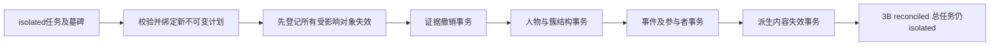

# 素材删除第3B阶段：精准撤证与共享记忆更新

实现日期：2026-11-10。基于 `media_deletion_analysis.md`、第2阶段和第3A阶段继续实现。前两个阶段在当前工作区尚未提交，本阶段保留其全部隔离与墓碑机制。

本阶段修改证据数组、共享对象的结构投影和有效性登记；**不物理删除 assets、observations、face_instances、SQLite/Qdrant源向量、原片、关键帧、文件或缓存**。不调用 cleanup_derivatives，不关闭外键，不调用模型，不生成摘要、画像或记忆图。迁移及测试仅在临时数据库执行，没有对实际素材库运行撤证。

## 1. 新增和修改的代码

以下为本阶段新增或继续修改的文件；前两阶段已有的其他工作区修改不算本阶段新增功能。

| 文件（相对仓库根目录） | 本阶段职责 |
|---|---|
| `apps/api/src/sentrix/infrastructure/persistence/migrations/0030_media_reconciliation.sql` | 新增5张元数据表，事务权限保护、旧结果拒写、有效性视图、历史结果失效 |
| `apps/api/src/sentrix/application/media/withdraw_evidence.py` | 类型化证据解析、精确撤销、保留其他任务的证据、不可判定依赖保护 |
| `apps/api/src/sentrix/infrastructure/persistence/reconciliation_support.py` | 有效性登记与代次、基于有效人脸的代表和原型重算 |
| `apps/api/src/sentrix/infrastructure/persistence/repositories/reconciliations.py` | 执行校验、计划换版、撤证审计、四步骤事务、恢复与幂等 |
| `apps/api/src/sentrix/infrastructure/persistence/database.py` | 可加入同一连接的写事务，连接内受控撤证权限；源数据屏障始终生效 |
| `apps/api/src/sentrix/infrastructure/persistence/repositories/deletion_plans.py` | 支持加入执行事务，将有效性/撤证/档案失效元数据纳入快照版本 |
| `apps/api/src/sentrix/api/routes/deletions.py` | 3B执行与进度查询API |
| `apps/api/src/sentrix/infrastructure/persistence/repositories/faces.py` | 受影响簇的原型刷新使用当前有效成员，避免旧代表恢复 |
| `apps/api/src/sentrix/infrastructure/persistence/repositories/entities.py` | 实体读取经有效性投影，保留身份、隐藏失效摘要 |
| `apps/api/src/sentrix/infrastructure/persistence/repositories/events.py` | 事件及其观察关联读取使用有效性投影 |
| `apps/api/src/sentrix/infrastructure/persistence/repositories/participants.py` | 参与者读取使用当前有效证据投影 |
| `apps/api/src/sentrix/infrastructure/persistence/repositories/structured.py` | 结构检索的事件、人物和证据桥使用有效视图 |
| `apps/api/src/sentrix/infrastructure/persistence/repositories/facts.py` | 人物关联读取使用安全实体投影，保留既有事实有效性过滤 |
| `apps/api/src/sentrix/infrastructure/persistence/repositories/relationships.py` | 关系关联的人物和事件读取使用有效投影 |
| `apps/api/src/sentrix/infrastructure/persistence/repositories/semantic.py` | 语义主张及关联实体读取保护 |
| `apps/api/src/sentrix/infrastructure/persistence/repositories/portraits.py` | 画像历史修订读取失效保护 |
| `apps/api/src/sentrix/infrastructure/persistence/repositories/family.py` | 家庭画像、关系、成员及其实体关联读取保护 |
| `apps/api/src/sentrix/infrastructure/persistence/repositories/appearance.py` | 外观证据关联的实体读取保护 |
| `apps/api/src/sentrix/infrastructure/persistence/repositories/moments.py` | 人物瞬间关联事件读取保护 |
| `apps/api/src/sentrix/infrastructure/persistence/repositories/memory_graph.py` | 节点、边、构建记录读取保护 |
| `apps/api/src/sentrix/infrastructure/persistence/repositories/memory_rotation.py` | 历史轮播失效保护 |
| `apps/api/src/sentrix/infrastructure/persistence/repositories/conversations.py` | 旧助手/工具消息不再进入有效上下文 |
| `apps/api/src/sentrix/infrastructure/persistence/repositories/turns.py` | 旧答案、候选集、trace及续传事件失效；保留分页rowid和事件序号分配 |
| `apps/api/src/sentrix/infrastructure/persistence/repositories/result_sets.py` | 旧档案结果集失效，保留历史源记录 |
| `apps/api/tests/integration/test_media_reconciliation.py` | 3B新增集成测试，含API、真实SQLite与本地Qdrant |
| `apps/api/tests/integration/test_media_deletion_plans.py` | 更新升级迁移的预期版本列表，保留3A测试语义 |
| `docs/media_deletion_phase3b.md` | 本文 |

## 2. 数据库迁移

`0030_media_reconciliation.sql` 在0028、0029之后应用。现有业务表不增加列，不改变 assets.status/deletion_state 和总删除任务的状态语义。

| 新表 | 键与主要字段 | 用途 |
|---|---|---|
| `media_reconciliations` | deletion_id PK；initial_plan_id、plan_id；status、step_index、retry_count、error；workset_json、plan_history_json；时间 | 持久执行及不可变计划绑定 |
| `media_reconciliation_steps` | (deletion_id,step) PK；result_json、completed_at | 各步骤提交检查点 |
| `media_object_states` | (object_table,object_key) PK；scope_id、validity、summary_valid、generation、reason、metrics_json、last_deletion_id、updated_at | 共享对象有效性、摘要失效、重算计数、版本及拒写依据 |
| `media_evidence_revocations` | (deletion_id,table,key,field,kind,id) PK；original_json、plan_id、created_at | 不可更新/删除的精确撤证审计 |
| `media_scope_invalidations` | scope_id PK；generation、cutoff_at、last_deletion_id | 档案级旧模型结果失效与聚合写入屏障 |

`object_key` 是按字段名排序的紧凑JSON，复合主键不会被简化成单个人物ID。有效性为 `valid / needs_review / invalid / revoked`；摘要另由 `summary_valid` 控制。人物身份可以 valid 而摘要失效。普通更新只能降低有效性；事件结构和人脸原型允许在受控事务中按有效证据恢复结构有效性，但不会恢复旧摘要。

旧共享表的 INSERT/UPDATE 屏障仅允许内部撤证协调器在同一写事务内通过。许可为每个Database的上下文变量及连接UDF，不是客户端可设置的SQL开关。资产、观察、人脸源实例、源向量和墓碑的屏障不绕过。登记过的受影响对象拒绝旧模型更新、REPLACE和删除；墓碑仍永久保留。

### 新API

- `POST /api/v1/media-deletions/{deletion_id}/reconcile`，请求 `{"scope_id":"s"}`。同步执行或从检查点恢复，返回执行记录、步骤结果、计划历史和对象有效性。
- `GET /api/v1/media-deletions/{deletion_id}/reconciliation?scope_id=s`，查询持久进度。
- scope校验沿用现有API内部访问保护和任务归属校验；错误scope不改变已有失败任务的状态。
- `status=reconciled` 仅表示3B结束。`media_deletions.status` 仍为 `isolated`，响应始终声明 `physical_deletion_complete=false`。

## 3. 执行前校验与计划换版

1. 验证任务isolated，所有成员资产隔离代次与任务成员一致。
2. 验证每个资产及当前观察、人脸实例均有对应 deletion_id、generation 的墓碑。
3. 视频通过递归父子关系再次核对完整闭包，发现不一致拒绝执行，不猜测修复。
4. 在同一 `BEGIN IMMEDIATE` 事务内重新生成当前快照计划并绑定。相同快照复用版本，变化创建新版本，不覆盖旧计划。
5. 每个步骤前再次校验和刷新计划；工作集合取旧集合和新集合的并集，防止已经撤证后依赖消失导致丢失后续失效对象。仍存在的对象使用最新计划描述，另核对当前scope。
6. 证据撤销、成员计数、事件结构按提交时的当前可读证据重算，不使用计划中的旧计数直接相减。
7. 其他任务已隔离但尚未撤证的证据不算有效支持；仍保留其原始引用，由所属任务自行撤销和审计。
8. 跨scope对象仅登记待复核/失效，不改其业务证据数组。缺失、混合来源或不可解析依赖不作精确删除猜测。

## 4. 各类对象的撤证规则

| 对象 | 处理规则 |
|---|---|
| facts、relationships | 仅移除能解析到本任务资产的证据。仍有有效或未知证据则pending/needs_review；无支持则retracted/invalid。保留原结论和confidence供审计，不把剩余引用当成原结论仍成立的证明 |
| entity_properties、semantic_claims | 同样精准撤证。语义主张另外解析 supporting_event_ids_json；共享事件引用保留，单素材事件可撤销。结果pending，原confidence/support_count保留但标为不可靠，读取侧屏蔽待复核结论 |
| entity_mentions、entity_observations、event_observations | 原桥行保留，针对精确复合键登记revoked及观察ID审计；可读视图不再交付该桥 |
| event_participants | 撤销本任务观察引用；只用仍有效、同scope、已确认人物的entity_mentions重建visible_subject。其他角色缺乏充分结构证明时待复核，不从事件摘要恢复 |
| event_entities | 撤销证据后，以当前entity_observations与项目EVENT_RELATIONS实体类型映射重算；不能因人物/地点仍出现就恢复任意旧关系 |
| family_relationships、family_person_memberships | 精确处理可识别证据；剩余语义结论待复核。独立人工维护且无素材依赖的记录保留 |
| 人物实体 | 不删除身份、名字和人工身份状态。登记有效观察/资产数量；旧模型summary失效。人脸簇ID或人物ID不是删除范围 |
| 人脸簇 | 源face_instances全部保留；仅当前有效实例参与成员数、代表脸、姿态原型和质量重算。代表实例失效后换为有效高质量实例；无有效实例时代表为空、数量0，不全局聚类 |
| 事件 | 按剩余可读观察重算时间、地点、封面、参与者和实体关联。时区语义混合时待复核。无有效观察则invalid；原summary留作历史，读取时为空，旧标题等模型聚合字段不交付 |
| 画像/摘要/语义档案 | entities.summary、events.summary、person_portrait_revisions、semantic_profiles、family_person_portraits建立失效状态。历史修订及user_locked但仍依赖素材的画像不作为当前证据；独立且明确source=user/user_override的无依赖内容保留 |
| 人物瞬间、外观证据 | 对受影响的派生内容登记失效，保留源记录和原始引用 |
| 记忆图 | 档案级构建状态失效，节点/边/构建记录读取过滤，旧构建写回仍被阻挡；不删除或重建图 |
| 轮播及历史检索 | 相关轮播失效；档案cutoff之前的旧结果集、助手答案、工具消息、trace与续传事件不作为有效输出/上下文，源历史保留 |
| 向量/全文索引 | 不删除任何源索引。继续走第二阶段权威过滤；失效事件摘要的SQLite向量不交付。Qdrant旧点保留，资产命中仍需当前SQLite状态通过 |

JSON字符串按字段约定的类型解释，例如evidence_ids默认observation、supporting_event_ids默认event；对象必须明确kind/id。相同文本ID的asset和entity不混淆。共享事件、人物、簇不是单条素材证据的同义词。未知或格式不合法的引用保留并标记，不使用SQL LIKE判断来源。

### 人工内容与保守写入策略

只有明确人工source/confidence_source且没有素材证据依赖的记录才能判为独立人工内容。仅有confirmed、user_locked或manual触发标签不足以证明结论脱离素材。无法可靠恢复聚合confidence/support_count时，不倒减，也不伪造新置信度。

现有模型结论没有统一的推理输入版本。为防止旧任务通过换新ID恢复结论，本阶段对已失效scope的facts、relationships、claims、properties及events聚合写入设置屏障；独立且明确标注的人工属性/主张可通过。实体旧模型summary也不能换ID写回。已有健康素材及其源检索仍可用，但该scope的自动聚合更新会暂停，直到后续引入带generation的可信重评估通道。不是按时间戳猜测任务是否新旧。

## 5. 事务、并发及失败恢复

准备阶段在首个提交前登记失效：即使在撤证步骤前失败，旧事实、事件和画像也不会在批次间继续作为有效证据。每步的业务更新、审计、检查点和step_index在同一个SQLite事务提交；提交前异常整步回滚，提交后异常从下一步恢复。失败记录写入status=failed及error；再次POST从持久检查点继续，retry_count递增。没有新增常驻自动重试调度器，进程重启后由再次调用恢复。

同任务和不同删除任务的写事务由SQLite BEGIN IMMEDIATE串行化；同进程多Database实例另外共享可重入锁。每步重新读取其他删除任务的当前隔离状态。检查点主键和撤证审计复合主键防止重复执行。同任务reconciled后重复请求不重新写业务行、计数、原型或撤证审计。对象generation与不可逆有效性防止另一删除任务误恢复语义结论。

跨SQLite/Qdrant/文件无新增删除动作：3B只修改SQLite共享业务与有效性元数据，不执行跨存储“先删一边”的非事务操作。原隔离机制继续承担文件发布和源索引写入屏障。

## 6. 测试及验证

测试均使用临时库、临时文件和确定性模型假件；本地Qdrant是真实本地索引。无需启动真实模型或评测。环境选择 `SENTRIX_VIDEO_KEYFRAME_ALGORITHM=window`，不依赖Katna安装。

新增 `test_media_reconciliation.py` 覆盖：单证据撤销、多证据保留、两个任务共享事实、多人脸素材共享身份/簇、缺少mention桥时按有效簇实例计数、代表实例切换、事件时间/封面/参与者/实体关系、间接历史画像、人工内容、无来源、跨scope、旧结果拒写、新ID绕过拒写、并发执行、不可变计划换版、提交前后故障恢复、重复执行、服务重建连接恢复、源行/文件/缓存/向量保留、旧图/轮播/历史结果失效、健康素材Qdrant检索、API与scope授权。原第2阶段/3A测试继续覆盖多级视频闭包、墓碑拒写、文件隔离、索引并发提交。

- 三阶段删除测试：**68 passed**（44项既有删除测试 + 24项3B测试）。
- 持久化仓储目录、3B核心新增文件、API及新增测试Ruff检查通过；核心三个模块strict mypy通过。
- 扩展回归：**361 passed，9 failed**；9个失败均在未修改主干上复现，详见下方。

扩展回归涉及迁移、身份、事件参与者、关系、语义、画像、家庭图谱、记忆图、时间线、召回、向量、助手回合、结果集HTTP契约。未修改HEAD通过git archive放入独立临时目录复测：记忆图测试仍patch已不存在的media_routes.build_memory_graph；8项助手测试仍把events_after返回的三元组当ProgressEvent。这9项在未修改主干同样失败，本阶段不修改无关接口或旧测试以使其表面变绿。

## 7. 尚未解决的问题和边界

1. 部分历史摘要、画像、语义结论没有字段级来源或推理输入版本，只能保守失效。完整JSON来源补录和按generation重评估属于后续工作。
2. 没有撤证后自动生成新摘要/画像/图谱，也没有解除有效性屏障的重评估API；不能通过普通业务写入把失效对象标回有效。
3. 画像人工编辑与素材依赖的来源不完整时，宁可不将其作为当前模型证据；历史正文保留，不能保证识别所有历史独立人工文本。
4. 人物/簇计数是执行当时的有效投影。后续健康素材进入时需要在未来重建流程中刷新人物计数；簇原型的现有刷新路径已接入有效成员重算。旧自动聚合在失效scope暂停，不能把“健康源数据可检索”理解为“该scope所有后台聚合继续照常”。
5. 计划生成仍需完整SQLite来源快照并可能盘点外部索引；在同一写事务内持锁，会阻塞并发写。大库需后续实现受版本保护的增量清单/更细批次。本阶段未做大规模性能压测。
6. 已经发送给客户端、复制到浏览器或已进入运行中模型内存的文本不能追回；新的持久化读取和检索不再将旧版本交付为有效证据。已有SSE连接的已发送内容无法撤回。
7. 不清理SQLite/Qdrant旧向量及FTS记录，不删除历史审计或原始文件；仍占用磁盘。过滤可能导致top-k候选不足，不能把隔离看作物理压缩。
8. 跨scope、混合来源和未知依赖只登记保守失效/复核，不自动撤销不确定的共享业务内容。无外部数据库连接绕过应用查询的兼容保证；直接读取原表是审计读取，不是有效证据读取。
9. 本阶段未在真实487题评测或实际相册执行，不声称线上数据已完成撤证；未启动服务、评测或模型任务。

## 8. 第3C阶段建议

1. 先验证3B reconciled、墓碑完整、共享对象仍有有效证据，以及最新不可变清理计划；不能仅看3A的exclusive分类就执行删除。
2. 使用PRAGMA foreign_key_list逐表盘点资产、观察、实例及桥/历史引用。重点包括media_deletions.root_asset_id、media_deletion_members.asset_id、资产parent_asset_id、face_instances、entity_mentions、event_observations、外观/瞬间、场景、音频、任务/结果历史等。
3. 先迁移删除账本、审计与不可变计划，使其只依赖永久墓碑身份或不依赖将被删除的业务行；目前根资产/成员FK仍会阻挡资产物理删除。本阶段不提前迁移或关闭外键。
4. 对确需保留的历史引用采用类型化墓碑身份或明确可空/历史快照；对专属桥按实例/观察复合主键处理。共享人物、簇、事件、事实和关系禁止级联整批删除。
5. 有外键的SQLite对象按引用拓扑从叶到根清理，视频按最深派生到根视频顺序；事务后执行foreign_key_check并复核其他素材关联及有效计数。
6. 向量使用完整(scope,space,source_type,source_id,model_name,collection,point_id)身份；FTS按精确观察/索引定位清理。Qdrant、文件、缓存作为持久化清理子任务，允许幂等重试，不宣称与SQLite原子提交。
7. 路径删除前验证所有权、允许目录、真实路径和共享引用；不能按人物ID、簇ID或相似文件名批删。
8. 保留墓碑和撤证审计，执行失败继续隔离；仅在所有清理子任务确认后，才引入总删除任务的最终完成状态。部署前备份并在真实结构副本上演练恢复。
