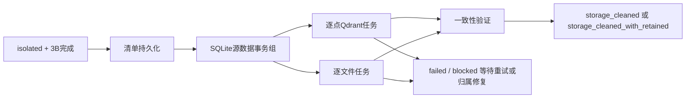

# 素材删除第3C阶段：专属数据物理删除与存储清理

实现日期：2026-11-10。基于第2阶段隔离、第3A阶段不可变影响计划和墓碑、第3B阶段精确撤证继续实现。仅在临时库、临时媒体目录及本地临时Qdrant中验证；没有对实际素材库执行清理，没有启动模型、评测或生产服务。

## 1. 文件与入口

| 新增/修改文件 | 职责 |
|---|---|
| `apps/api/src/sentrix/infrastructure/persistence/migrations/0031_media_cleanup.sql`（新增） | 删除账本外键迁移、清理执行/资源/检查点表、待清理路径防复用、受控源资产DELETE许可 |
| `apps/api/src/sentrix/infrastructure/persistence/repositories/cleanups.py`（新增） | 前置校验、清理清单、动态外键检查、SQLite事务组、Qdrant及文件资源重试、最终一致性检查 |
| `apps/api/src/sentrix/infrastructure/media/cleanup_files.py`（新增） | 受管根目录、来源与文件身份校验、no-follow目录描述符删除 |
| `apps/api/src/sentrix/infrastructure/vector/qdrant_index.py` | 单个完整身份点的delete_exact及残留检查；保留原隔离写屏障 |
| `apps/api/src/sentrix/infrastructure/persistence/database.py` | 注册路径规范化函数，供路径保留触发器使用；外键始终ON |
| `apps/api/src/sentrix/infrastructure/persistence/repositories/deletions.py` | 根资产已物理删除后，重复请求仍返回原任务；保留scope和幂等键冲突检查 |
| `apps/api/src/sentrix/infrastructure/persistence/repositories/reconciliations.py` | 已完成3B的重复调用支持源行已由3C删除的情况，不重新运行撤证 |
| `apps/api/src/sentrix/api/routes/deletions.py` | 新增3C执行和查询API |
| `apps/api/src/sentrix/application/media/import_assets.py` | 失效scope的新健康导入保留源观察/索引，推迟受保护的共享记忆聚合 |
| `apps/api/src/sentrix/bootstrap/import_wiring.py` | 接入scope聚合准入；失效scope不调用记忆图重建 |
| `apps/api/tests/integration/test_media_cleanup.py`（新增） | 3C临时存储、故障、恢复、安全与健康路径测试 |
| `apps/api/tests/integration/test_media_deletion_plans.py` | 更新升级测试迁移列表，加入0031 |
| `docs/media_deletion_phase3c.md`（新增） | 本文 |

此前第2/3A/3B工作仍在同一工作区中；以上是本阶段新增或继续修改的模块，并非整个工作区的全部差异。

### API

- `POST /api/v1/media-deletions/{deletion_id}/cleanup`，请求 `{"scope_id":"s"}`：创建清理清单并执行，或重试未完成步骤。
- `GET /api/v1/media-deletions/{deletion_id}/cleanup?scope_id=s`：查询源数据事务、各资源状态、检查点、计划与验证结果。
- 返回cleanup status和`validation.storage_cleaned`；`total_deletion_complete`始终false。
- 错误scope返回404；未完成3B或不满足隔离条件拒绝执行。部分外部失败返回持久执行状态，不伪造清理成功。

## 2. 外键与历史账本迁移

### 迁移前盘点

运行时不仅使用固定表列表，还通过所有表的`PRAGMA foreign_key_list`检查每个将被删源行的引用者。

| 源表 | 当前引用者 |
|---|---|
| assets | assets.parent_asset_id、observations、asset_places、events.source_asset_id、face_instances、外观/瞬间、video_jobs，以及迁移前的删除任务和成员 |
| observations | event_observations、face_instances、entity_mentions、entity_observations、外观/瞬间 |
| face_instances | face_prototypes、entity_mentions、外观/瞬间 |
| events | event_observations、event_participants、event_entities、person_moments |
| video_jobs | video_job_stages |
| import_jobs | import_job_stages；import_jobs.asset_id本身没有资产FK |

当前video_jobs与video_job_stages存在CASCADE，本阶段仍先明确删除阶段行，再删除任务行，最后删除资产，不依赖级联替代清单。

### 0031做什么

1. 解除`media_deletions.root_asset_id`和`media_deletion_members.asset_id`对assets的FK，保留原ID、唯一性、scope、generation和其他全部字段。成员到删除任务的FK仍保留。
2. 为避免SQLite替换父表时的FK计数问题，同一迁移事务内先将六张账本表复制至临时备份：任务、成员、计划、3B执行、步骤、撤证审计。
3. 暂时移除这几张账本的不可变触发器；按引用者优先顺序清空账本，重建两个去除源资产FK的表，然后按父到子恢复原记录，恢复不可变触发器，移除临时备份。**没有清空业务素材表或墓碑**。
4. 所有历史ID、JSON、代次、撤证记录在同一事务恢复。迁移失败整笔回滚。测试用已有isolated且3B完成的真实临时任务验证逐行内容一致、foreign_key_check为空、foreign_keys=1。
5. media_deletion_plans本来只引用删除任务，不引用源资产；media_tombstones本来没有源FK，均继续保留。
6. import_jobs及其阶段保留取消状态和历史资产ID；视频任务/阶段的完整原记录在清理manifest中留档，再明确删除源业务任务行。

不执行PRAGMA foreign_keys=OFF，不引入业务共享表的CASCADE。不迁移、删除人物、事实、关系、画像表。

### 新表

| 表 | 数据 |
|---|---|
| media_cleanups | deletion_id PK、当前plan_id FK、status、sqlite_done、retry_count、error、manifest_json、validation_json、创建/更新时间 |
| media_cleanup_resources | (deletion_id,resource_id) PK；file/qdrant/inventory种类；状态、完整locator_json、原始及规范化路径、attempts、error、更新时间 |
| media_cleanup_steps | (deletion_id,step) PK；步骤结果与完成时间 |

manifest保存源资产/观察/实例/专属事件ID、选中的每一行及其完整主键、源行原内容、视频任务/阶段、完整向量键、文件版本、来源计划版本、源数据版本和阻塞原因。执行前重新生成当前不可变影响计划；安全通过时记录实际执行计划、初始计划及计划历史，不覆盖旧3A计划。

## 3. 执行前校验和专属归属

- 总任务必须isolated，3B执行必须reconciled且步骤进度为4。
- 校验成员、源状态/代次、资产/观察/人脸墓碑与任务scope/deletion_id一致；视频再次递归核对派生闭包。
- 清理manifest持久化后，在SQLite实际删除事务内再次校验并重新生成计划；源行、闭包、文件版本发生变化时停止SQLite组，保存原因，不直接覆盖旧清单后继续删。
- 事实、关系、属性、主张、家庭证据JSON仍含本任务应撤销的精确证据时阻塞，跨scope证据同样不会猜测删除。历史已失效画像、摘要及审计保留逻辑历史ID，不作为有效证据读取。
- 源行通过asset_id、observation_id、face_instance_id及实际复合键识别，不按人物或簇整批清理。来源混合的专属行、跨scope行、未在清单内的实际FK引用均阻塞。
- 事件只有在当前所有观察/源资产均属于目标、同scope且3B已标invalid时才是候选。任一保留引用、其他素材观察、未撤销的JSON依赖或共享source_asset_id情况都会保守停止；不自动拆断共享事件的源FK。
- 事实和关系业务行不物理删除；3B撤证后状态、证据和审计保持原样。
- 人脸簇代表、有效原型和其他素材的实例保留；只清除仍引用目标实例、且3B已失效的旧原型。
- 新增未知来源的外键表也会被动态检查发现；没有已授权归属规则就保留并阻塞，而不是让CASCADE处理。

## 4. SQLite删除顺序

在一个`BEGIN IMMEDIATE`源数据事务组内，按下列依赖顺序明确删除，并记录各表检查点；所有检查点和`sqlite_done=1`随源数据一起原子提交：

1. observation_search_fts、observation_search_terms。
2. memory_vectors、text_vectors：按选中行的完整唯一身份与行主键删除；保留space、source_type、source_id、model_name、scope及dimension定位，不假设一个素材只有一个模型版本。
3. entity_mentions、entity_observations、event_observations中的专属桥。
4. person_appearance_evidence、person_moments中的专属行。
5. 引用目标实例且已失效的旧face_prototypes。
6. 专属无效事件的event_participants、event_entities。
7. face_instances，再observations，再asset_places。
8. video_job_stages，再video_jobs。
9. 已确认专属且无保留引用的events，先登记event永久墓碑。
10. assets从最深派生到根逐行删除。
11. 同事务检查foreign_key_check为空；提交SQLite源数据组。

不调用cleanup_derivatives。普通业务调用仍不能删除isolated资产，只有存在3C清单、任务isolated、3B完成、墓碑与代次一致的内部事务可通过资产DELETE屏障；源INSERT/UPDATE屏障不解除。

## 5. Qdrant和文件清理

### Qdrant

- SQLite提交后，根据持久化源身份盘点Qdrant，因此首次盘点离线也不阻止SQLite已提交部分保留进度。
- 按scope、space、source_type、source_id、model_name、collection和实际point_id建立逐点资源任务；从实际payload确认来源。SQLite向量的模型/维度等信息也已在manifest留档。
- event向量只有明确指向目标观察的专属投影或专属事件才可清理；混合来源、跨scope、未知类型或非受管collection保留并阻塞相应资源。
- delete_exact再次retrieve并比较完整身份及metadata；payload变化则拒绝删除。只用PointIdsList删除具体点，不删除collection。
- wait完成后再次retrieve，最终再全量盘点目标来源残留。模型版本不同的点分别清理。
- collection/点不存在按幂等成功；索引不可用保存failed inventory/point任务，之后POST可重试。
- 外部失败不回滚SQLite。源墓碑和现有vector_write_barrier继续阻挡旧任务upsert；不承诺阻挡绕过应用适配器的外部管理员直接写Qdrant。

### 文件

- 删除数据库行前，保存资产原片、已知预览/缩略图、media/derived/video及svd/svd_katna规划目录文件、video-jobs目录/阶段产物、其他可确认产物的原路径、真实路径、所有者、stat版本。
- 根目录仅允许配置data_dir下面的media、previews、video-jobs。还要求资产ID命名规则或精确资产/任务目录等所有权证据；仅“位于data目录”不够。
- 外部导入源文件和评测数据集不会删除。仅作为import_jobs.original_path出现的源文件保留；同时是受管系统资产原片时须另通过受管归属校验。
- 删除前持SQLite写锁，重新扫描**全部scope**的资产路径、浏览预览、其他导入原路径、视频阶段产物以及同inode引用。其他资产仍引用时retained_shared。
- 两个清理任务共用文件时，不根据初始快照直接判定可删除或永久共享；实际unlink前重新核对所有者。最后一个所有者清理时可使用先前受管共享文件的版本记录证明归属。
- 用规范化路径检查根目录，并从可信根打开O_DIRECTORY/O_NOFOLLOW描述符；逐段打开目录，最终lstat要求普通文件。拒绝符号链接、目录替换、越界、数据集路径及无归属文件，不递归rmtree。
- 删除前比较device/inode/size/mtime_ns，版本变化保留并blocked；unlink使用dir_fd并fsync目录。文件/父目录不存在按成功处理。
- 待清理路径登记后，资产INSERT/改path不能重新采用这些保留路径或其规范化别名，防止检查和清理间产生新的资产所有者。永久保留的共享/外部资源不施加独占路径保留。
- 单文件失败持久化为failed；安全归属不确定为blocked。空目录不递归删除，未知进程临时文件没有来源时保留。

## 6. 检查点、恢复与状态

- 执行状态：running、failed、blocked、storage_cleaned、storage_cleaned_with_retained。
- 资源状态：pending、failed、blocked、done、retained_shared、retained_external。
- SQLite提交前失败全部回滚，sqlite_done保持0；提交后中断则跳过源删除组，继续外部资源。
- 每个点、每个文件单独保存进度。外部动作成功但保存检查点前中断，再执行会发现资源不存在，按幂等成功完成。
- 同任务重复完成调用返回持久结果，不重新撤证或删除。同/不同任务由SQLite事务串行化关键所有权判断；外部失败不撤销已提交状态。
- 服务重启后通过同一POST继续；本阶段没有新增常驻自动重试调度器。
- blocked不会因普通重试被当作成功；未知来源、变化文件和新依赖需要明确修复/重新确认，没有提供绕过安全校验的force接口。
- 总media_deletions仍isolated。storage_cleaned是已确认清单的存储清理完成，storage_cleaned_with_retained另有合法共享/外部保留资源；二者均不等于总删除完成。

## 7. 一致性校验与测试

最终检查：清单中源行不存在、FTS按观察身份无残留（不依赖可复用rowid）、受管已完成文件不再出现、Qdrant无目标来源残留、各资源无failed/blocked/pending、墓碑与任务归属正确、foreign_keys=1、foreign_key_check为空。共享对象由3B结果保留；测试逐行比较人物、簇、事实、关系及撤证审计清理前后一致。

新增测试包括：单图片、多级视频/场景、共享人物/簇/事实/事件、跨scope共享文件、最后所有者与并发清理、双模型/文本/不同源类型向量、真实FTS、已有isolated任务迁移、SQLite提交前后中断、Qdrant离线及删除失败、文件失败、外部动作后检查点丢失、外部源/数据集/符号链接保护、新增未知FK、待清理路径防复用、旧观察/文件发布/向量写回拒绝、文件被替换后的拒删、取消导入历史保留、健康素材后续导入和HTTP检索。

新问答回归使用脚本模型和RunTurn同步执行，检索真实临时Qdrant，交付前核对真实SQLite资产；只交付健康素材，不依赖HTTP后台worker或真实模型。

最终测试结果见本文末尾验证记录。所有测试均在临时资源中执行。

## 8. 残留与第3D阶段输入

### 已知残留与安全边界

1. 共享人物、簇、事实、关系、已失效画像/摘要/图谱及历史证据保留；不恢复失效状态，不运行模型重建。
2. 跨scope证据未撤销、未知FK、混合来源向量、共享source_asset_id事件、文件版本变化等会阻塞对应清理组/资源，不猜测修复。SQLite源组选择整体原子提交，因此一条不安全源依赖可能暂时保留整组源数据。
3. 共享/外部文件合法保留，空目录保留；无统一artifact registry的进程临时裁剪、未知缓存不自动删除。验证仅覆盖已登记和本阶段已盘点的身份/位置，不能声称已发现所有历史未知临时文件。
4. 非常大的数据库/Qdrant仍需完整来源/外部盘点；SQLite源组及部分外部检查持锁，未做真实大库性能压测。
5. 文件系统外部管理员不遵守发布屏障时，仍可能在清理后创建新文件；重试不能恢复旧源数据，验证发现已知路径重现会阻塞。已完成调用不会当作持续磁盘监控。
6. 部分永久blocked项没有本阶段的人工授权解除/清单替换接口，需后续可信归属修复工具；不能通过更改状态值直接force删除。
7. 清理后的新健康素材可以保存观察、源索引并检索；scope共享聚合仍暂停，新的人脸归簇、事件、属性、事实和图谱投影等待3D。不会以恢复旧任务为代价让所有后台聚合继续。
8. HTTP助手旧契约的worker生命周期夹具问题不在本阶段修改范围，见验证记录；真实模型/实际相册/487题评测未运行。

### 第3D需要的输入和状态

- deletion_id、scope、永久墓碑、成员代次，3B撤证审计及对象generation。
- 3C实际执行plan_id/初始计划/历史、完整manifest、sqlite_done、资源状态和最终validation。
- media_object_states中needs_review/invalid/revoked、summary_valid及受影响对象ID；不能把旧summary、portrait历史正文当新证据。
- media_scope_invalidations的scope代次/cutoff，以及本阶段之后新导入的有效资产、观察、实例、源向量。
- 保留文件的所有者和理由；blocked项待修复清单。3D不得绕过未解决的跨scope/来源冲突。
- 后续建立带输入generation、源证据集合、任务fence和幂等键的重建任务，再按当前有效证据重评事实/关系、补齐聚合、重建摘要/画像/图谱。
- SQLite源组未完成时不得将其当作已完成清理的重建基础；存储failed/blocked应保持状态区分。重建成功并通过一致性检查后，才设计独立总删除完成状态，3C不设置它。

## 最终验证记录

- 删除专项（第2/3A/3B/3C）：**96 passed**，其中本阶段新增**28项**。
- 定向扩展回归（删除专项、导入流水线、迁移、Qdrant、身份仓储、多路召回）：**168 passed**。
- Ruff：本阶段相关仓储、数据库、文件/向量适配器、API、导入装配和新增测试检查通过；git diff --check通过。
- strict mypy：清理仓储、文件适配器、Qdrant、ImportAssets、删除API、删除仓储、数据库、3B协调器共**8个模块通过**。
- 额外检查bootstrap/import_wiring的strict类型时，发现既有ImportJobRepository协议缺少begin_postprocess_stage/update_postprocess_progress声明两项问题；不声称全项目类型门禁已通过。
- 扩大到旧身份导入和助手HTTP契约时有9项既有失败：1项身份导入旧存储假件缺少copy_from_path，8项助手契约未启动/不匹配当前worker生命周期。对未修改HEAD的git archive副本运行同组测试，复现相同**9 failed、26 passed**。本阶段不改这些无关协议或夹具。
- 新增的删除后问答测试同步运行真实RunTurn与持久化仓储、真实临时Qdrant、脚本模型，验证只检索/交付健康素材；并非真实模型质量评测。
- 命令示例：`SENTRIX_VIDEO_KEYFRAME_ALGORITHM=window .venv/bin/pytest -o addopts='' -q apps/api/tests/integration/test_media_cleanup.py apps/api/tests/integration/test_media_deletion.py apps/api/tests/integration/test_media_deletion_plans.py apps/api/tests/integration/test_media_reconciliation.py`。
- 唯一测试告警为现有Starlette/httpx弃用提醒。未迁移实际素材库，未对真实文件执行3C。
