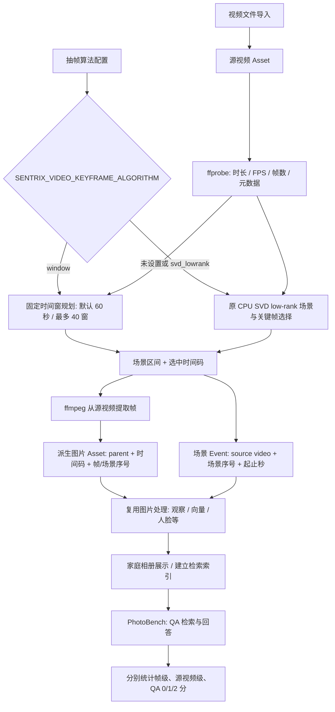

# 2.0 视频抽帧流程、复现口径与统一接口

日期：2026-10-23  
范围：`sentrix-home-web-2.0` 视频导入、关键帧生成、家庭相册与 PhotoBench；不包含独立本地 keyframe benchmark 的 Hybrid v2 数据或成绩。

## 目标

把“视频如何变成可检索的相册记忆”与“如何比较抽帧、检索及 QA”使用同一套来源和时间坐标。模型、提示词及模型参数沿 Web2 原工程配置，不为 benchmark 私自换模型；算法结果必须能回溯到源视频、算法配置和运行批次。

## 当前 2.0 流程



默认关键帧算法为原 SVD low-rank；`SENTRIX_VIDEO_KEYFRAME_ALGORITHM=window` 可显式切换到固定时间窗。SVD 实现与配置随 API 包发布，不依赖外部源码目录或 YOLO 权重。Web2 将 SVD 结果适配为场景窗，再走同一派生图片及图片处理链。语音片段仍使用源视频秒数，并按片段与场景的时间重叠写入对应场景记忆；详情接口同时返回场景内关键帧时间，前端在对应语音片段旁展示可核对的时间点。

### 当前已有的数据结构

| 对象 | 现有字段/语义 | 时间坐标 |
|---|---|---|
| 源视频 | Asset ID、文件名、媒体类型；ffprobe 元数据含时长、FPS、分辨率、帧数等 | 源视频时间轴 |
| 场景/片段 | `source_asset_id`、`source_scene_index`、`source_start_sec`、`source_end_sec` | 源视频秒数 |
| 关键帧图片 | `parent_asset_id`、`source_timestamp_sec`、`source_frame_index`、`source_scene_index` | 源视频秒数及帧序号 |
| QA 评测 | QA、答案、0/1/2 分判分、检索计数 | 目前主要能关联源视频；当前数据集没有统一的 GT 帧时间区间 |

事件上的 `time_start/time_end` 是拍摄时间/事件时间；`source_start_sec/source_end_sec` 和 `source_timestamp_sec` 才是播放器定位所用的原片时间。两者不可互换。

## 当前复现状态与缺口

- 已有 43 个视频、298 条 QA 的 Web2 测试结果；复测应使用同一份清单和同一模型配置，分别记录算法名与配置，不与独立 keyframe benchmark 混数。
- 已有源视频级 QA 目标标注及检索命中统计；没有 QA 对应的 GT 关键帧 ID/时间范围，因此目前不能声称帧级召回率。
- 需要保留每个输入视频的 SHA-256、视频 ID、QA ID、目标视频 ID、算法与配置版本、代码 commit、模型/提示词版本、检索参数、数据范围和运行时间，确保能复跑并比较。
- **接口待修正：** 当前抽取用例把场景序号同时写入 `source_frame_index`。这不是源视频实际帧号；SVD 原始结果已提供实际帧序号/时间码，但适配层没有完整保留帧号。现阶段时间码可定位，不能把该序号当作实际源帧号用于帧级评分。修正后应保留算法返回的实际源帧索引；若解码器可提供 PTS，也应把 PTS/时间基保存为定位事实。
- 抽帧配置及输入视频哈希需要纳入 benchmark manifest；SVD 所需模型按 Web2 原工程依赖和现有模型版本运行，不替换模型或参数。运行中记录设备、模型加载/释放及错误情况，避免重复常驻造成内存压力。

## 统一指标口径

每层分开报告，禁止用 QA 得分代替抽帧质量，也禁止把“找到视频”写成“找到关键帧”。

| 层级 | 指标 | 分子 / 分母 | 当前能否计算 |
|---|---|---|---|
| 帧级抽取/检索 | 帧命中率（帧级 Recall@K） | 命中的 GT 关键帧/时间区间数 / 已标注 GT 数 | 不能；需为 QA 标注关键帧 ID 或相关时间区间，并明确命中容差/区间重叠规则 |
| 源视频级检索 | 源视频命中率（Video Recall@K） | Top-K 中包含目标源视频的 QA 数 / 有目标源视频标注的 QA 数 | 可以；当前数据的统计为 36/74 与 105/224，旧报告的百分比保持不变 |
| 回答质量 | 1 分正确率 | 恰好得 1 分的有效判分 QA 数 / 有效判分 QA 数 | 可以；只统计 1 分，不含 2 分 |
| 回答质量 | 2 分正确率 | 得 2 分的有效判分 QA 数 / 有效判分 QA 数 | 可以 |

QA 评分沿当前 Web2 口径：0 分=核心问题错误或未完成；1 分=主要内容正确但有遗漏/错误；2 分=核心要求正确且完整。分别报告 1 分、2 分率和有效判分数；没有有效判分的记录不塞入 0 分分母。当前结果详见 [`20261022-svd-lowrank-mac-progress.md`](20261022-svd-lowrank-mac-progress.md)。

帧级命中规则需要先由产品/评测确认后再用于正式结果。建议标注相关帧时间区间，并在同一版本中固定“时间差容差”或“区间交并比”规则；未完成这一步前，只发布源视频级命中率和 QA 分数。

## 建议统一接口

以向后兼容方式扩展现有 API/存储，不另造与相册不兼容的一套 benchmark 资产：

```text
VideoSource
  video_asset_id, sha256, duration_sec, fps, frame_count

SceneSegment
  video_asset_id, scene_index, start_sec, end_sec

Keyframe
  frame_asset_id, video_asset_id, scene_index,
  timestamp_sec, source_frame_index, pts/time_base,
  algorithm, algorithm_version, config_hash

BenchmarkCase
  qa_id, expected_video_asset_ids, expected_frame_intervals[],
  retrieved_video_asset_ids[], retrieved_frame_asset_ids[],
  answer_score(0|1|2|null), run_id
```

统一约定：时间字段一律是源视频时间轴秒数（数值型，保留小数），帧序号是解码器报告的源帧索引而非场景序号；`scene_index` 只标识片段。当前无 PTS 时可为空，不伪造。`algorithm/config_hash/run_id` 随结果保存，使相册详情、benchmark 行和导出记录能互相追溯。

## 复现验收

1. 固定 43 个源视频及 SHA-256、298 条 QA、目标源视频标注；另附新增帧级区间标注版本（完成后）。
2. 固定 Web2 commit、算法及其配置、模型版本/提示词和检索参数；严格使用 Web2 原项目模型，不变更模型。
3. 每个算法使用独立 `run_id` 和输出/索引命名空间；先完成一轮、保存结果并释放模型，再开始下一轮，避免并发加载占用内存。
4. 同一输入和配置重复运行一次核验稳定性；比较帧数、关键帧时间码、耗时、帧/视频检索命中和 QA 分数。
5. 相册展示源视频、片段起止、关键帧时间码；PhotoBench 按 run 展示 Video Recall@K、帧级指标（标注后）及 1 分/2 分正确率。

## 范围与投入估算

**本阶段范围：** 固定现有 43 视频/298 QA；修正时间码与实际帧号血缘；统一运行清单和结果字段；相册/benchmark 可追溯呈现；复跑并整理源视频级检索和 QA 1/2 分结果。模型与题库内容不改。

| 工作 | 估算 |
|---|---:|
| 统一血缘字段与 API/存储兼容、回归测试 | 1–2 人日 |
| 复现清单、运行隔离/释放、重复运行 | 1–2 人日 |
| 帧级/视频级/QA 指标和页面/导出对齐 | 1–2 人日 |
| 端到端复测及报告核对 | 1 人日 |
| **第一阶段小计（不含新增标注）** | **4–7 人日** |
| 43 个视频对应帧级相关区间标注与抽检 | 另计约 2–4 人日 |

总计约 **6–11 人日**（含帧级标注），主要取决于相关片段数量与复核工作量。若先交付源视频级检索和 QA 1/2 分率，第一阶段约 **4–7 人日**，帧级指标在标注完成后补入。
